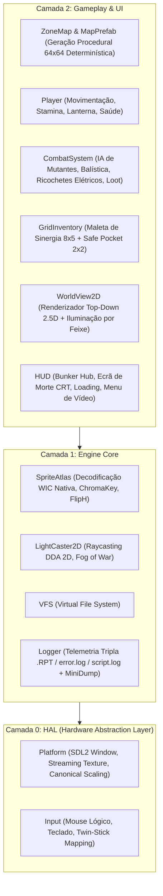

# 📓 DEVLOG — DIÁRIO DE ENGENHARIA E DESENVOLVIMENTO DO ZONE PROTOCOL

> **Projeto:** ZONE PROTOCOL  
> **Versão Atual:** `v0.1.4` (`v014`)  
> **Documento Diretor ("GPS"):** [`PROJECT_MATRIX_ZP.md`](file:///C:/Users/luizc/Documents/ROOTSZERA/Projetos/GAME/ZONE%20PROTOCOL/PROJECT_MATRIX_ZP.md)  
> **Referência de Design & Retenção:** [`referencia/ideias de implementacao.md`](file:///C:/Users/luizc/Documents/ROOTSZERA/Projetos/GAME/ZONE%20PROTOCOL/referencia/ideias%20de%20implementacao.md)  
> **Stack Tecnológica:** C++17 Nativo, SDL2, Windows Imaging Component (WIC), DbgHelp, CMake 3.16+  
> **Plataformas Alvo:** PC Desktop (`1920x1080` 16:9 / `1280x720` 16:9) & Valve Steam Deck (`1280x800` 16:10 @ 60 FPS)

---

## 🎯 1. PROPÓSITO DESTE DIÁRIO E ALINHAMENTO COM A MATRIZ (`PROJECT_MATRIX_ZP`)

Este `DEVLOG.md` documenta cronológica e tecnicamente cada etapa da construção do **ZONE PROTOCOL**, registrando:
1. **O que foi implementado** em cada versão e ciclo de engenharia.
2. **Os desafios e bugs encontrados** durante o desenvolvimento real.
3. **O diagnóstico técnico da causa raiz** (matemática de coordenadas, memória, pipeline gráfico).
4. **A solução implementada**, explicando **como funciona** no código e **por que foi desenhada dessa forma**, respeitando a filosofia **Zero Bloat**, **Determinismo Procedural** e **60 FPS cravados** definidos no [`PROJECT_MATRIX_ZP.md`](file:///C:/Users/luizc/Documents/ROOTSZERA/Projetos/GAME/ZONE%20PROTOCOL/PROJECT_MATRIX_ZP.md).

---

## 🏗️ 2. VISÃO TÉCNICA DA ARQUITETURA DA APLICAÇÃO

O **ZONE PROTOCOL** foi projetado sobre uma arquitetura estrita em **3 Camadas Desacopladas**, sem dependências pesadas externas e com renderização via software direta em memória (`uint32_t` ARGB8888) transferida via textura *streaming* para a GPU:



### Por que essa arquitetura foi escolhida?
* **Performance Determinística (Regra Zero Alocações no Loop):** Ao operar sobre um `std::vector<uint32_t> m_screenBuffer` pré-alocado na troca de resolução, o motor desenha pisos, paredes, luz DDA, partículas, sprites e interface gráfica diretamente na CPU com localidade de cache Nível 1/2 e faz um único upload por frame (`SDL_UpdateTexture`).
* **Independência de GPU / Drivers:** Funciona com exatidão idêntica em GPUs integradas, notebooks de entrada, Steam Deck (via Proton/Nativo) e monitores 4K, mantendo estética *pixel-art* nítida via `SDL_ScaleModeNearest`.

---

## 📜 3. HISTÓRICO DE DESENVOLVIMENTO — LINHA DO TEMPO

---

### 🔹 FASE 1: Fundação da Engine & Transição Top-Down (`v0.1.0` – `v0.1.1`)

#### O que foi implementado:
1. **Reaproveitamento da Infraestrutura Base (~75%):** Aproveitamento das classes fundamentais de sistema, matemática (`MathDef.hpp`), arquivos virtuais (`VFS`) e objetos estruturais (`Porta`, `JanelaFixa`, `JanelaAbrir`, `LinhaTrem`).
2. **Motor de Iluminação Tática `LightCaster2D` (DDA 2D):**
   * **Como funciona:** Utiliza o algoritmo *Digital Differential Analysis* (DDA) para disparar raios a partir da posição do Operador dentro do ângulo do cone da lanterna. O raio avança célula por célula na grade do `ZoneMap` até colidir com uma parede opaca ou atingir o alcance máximo.
   * **Por que foi implementado:** Garante sombras duras e oclusão de visão realistas em tempo real sem custo de *shaders* complexos, criando a tensão essencial onde o jogador só enxerga o que está na linha de visão direta da lanterna.
3. **Geração Procedural Híbrida (`ZoneMap` + `MapPrefab`):**
   * **Como funciona:** Combina geração baseada em semente (`std::mt19937`) com carimbos de estruturas pré-desenhadas (`police_station.ddprefab`), estradas asfaltadas, portas interativas e pontos de extração.
   * **Por que foi implementado:** Atende ao *Anti-Pattern* da Matriz que proíbe geração puramente caótica; garante que os prédios façam sentido tático enquanto o loot e os inimigos mudam a cada incursão.

---

### 🔹 FASE 2: Marco de Lançamento no GitHub — Release `v0.1.2` (`Commit 6ef92ab`)

#### O que foi implementado:
1. **Carregador Nativo de Imagens `SpriteAtlas` via Windows WIC (`wincodec.h`):**
   * **Desafio:** Carregar folhas de sprites `.png` de alta resolução (`2048x2048`) sem adicionar bibliotecas externas pesadas (`SDL_image` ou `libpng`) que quebrariam a filosofia *Zero Bloat*.
   * **Solução Técnica:** Uso da API nativa do Windows (`IWICImagingFactory`, `IWICBitmapDecoder`, `IWICFormatConverter`) convertendo qualquer PNG diretamente para `32bppBGRA` em memória e aplicando *Chroma Key* automático.
2. **Maleta de Sinergia Inicial e Bolso Seguro (`Safe Pocket 2x2`):**
   * **Como funciona:** Sistema de inventário matricial (`GridInventory`) onde armas (`AK-74M`), itens médicos e artefatos (*Isótopo Zaria*, *Núcleo Spark*, *Cristal Crio*, *Orbe Compasso*) ocupam células 2D. O algoritmo `recalculateSynergies()` varre itens ortogonalmente adjacentes e cria conexões (`SynergyLink`) que alteram os atributos da arma em tempo real:
     * **Verde (`RAD_GREEN`):** +25% Dano base por link + Queimadura radioativa contínua (`+8 DPS/s`).
     * **Roxo (`ELEC_PURPLE`):** +25% Cadência de disparo + Ricochete elétrico em cadeia que salta entre mutantes próximos (`ElectricArcFX`).
     * **Azul (`CRYO_BLUE`):** +15% Dano + Efeito *Cryo-Slow* (reduz a velocidade do mutante atingido em 50%).
   * **Por que foi implementado:** Materializa a Regra de Ouro nº 2 e nº 3 da Matriz: sinergias visuais/mecânicas reais e proteção contra frustração na morte através do *Safe Pocket 2x2*.
3. **Loop de Estados Completo (`main.cpp`):**
   * Máquina de estados com 4 estágios integrados: `LOADING_SECTOR` $\rightarrow$ `IN_ZONE` $\rightarrow$ `DEATH_SCREEN` $\rightarrow$ `BUNKER_HUB`.
4. **Sistema de Diagnóstico e Telemetria Tripla (`Logger`):**
   * Geração de `.RPT` (auditoria de hardware CPU/GPU/RAM e assets), `error.log` (com *Live Game State Snapshot* e captura de *Stack Trace* via `DbgHelp` + `.dmp` em caso de exceção SEH) e `script.log`.

---

### 🔹 FASE 3: Ciclo de Refinamento Pós-GitHub — Release `v0.1.3` (Desafios Reais & Soluções de Engenharia)

Após subir a versão `v0.1.2` para o GitHub, realizamos uma bateria intensiva de testes visuais e de usabilidade. Abaixo estão documentados todos os problemas diagnosticados e as soluções definitivas implementadas no código:

---

#### 🛠️ Desafio 3.1: O Operador e os Monstros Giravam no Próprio Eixo ("Pirueta de 360°")
* **Sintoma Visual:** Ao caminhar em qualquer direção, tanto o Operador quanto os mutantes pareciam girar loucamente (Frente $\rightarrow$ Costas $\rightarrow$ Direita $\rightarrow$ Esquerda) a cada `0.10s`, em vez de executarem o ciclo de passos na direção do movimento.
* **Diagnóstico Técnico (Causa Raiz):**
  * Nas folhas de sprites (`sprites_player_anim.png` e `sprites_entities.png`), as **4 colunas** (0, 1, 2, 3) representam as **4 direções cardeais** (Baixo/Frente, Cima/Costas, Direita, Esquerda), enquanto as **linhas** representam as **fases do movimento** (Parado, Passo 1, Corrida, Dano).
  * O código anterior incrementava o índice da **coluna** com base no tempo (`col = static_cast<int>(time / 0.10f) % 4`), fazendo o personagem trocar de direção a cada frame de animação.
* **Solução Implementada ([`WorldView2D.cpp`](file:///C:/Users/luizc/Documents/ROOTSZERA/Projetos/GAME/ZONE%20PROTOCOL/Zone%20Protocol/src/game/UI/WorldView2D.cpp)):**
  * Criada função determinística de mapeamento direcional para fixar a coluna pelo vetor de visão `(dirX, dirY)`:
    ```cpp
    int dirCol = 0;
    if (std::abs(dirX) > std::abs(dirY)) {
        dirCol = (dirX > 0.0f) ? 2 : 3; // Coluna 2 = Leste (Direita), Coluna 3 = Oeste (Esquerda)
    } else {
        dirCol = (dirY > 0.0f) ? 0 : 1; // Coluna 0 = Sul (Frente), Coluna 1 = Norte (Costas)
    }
    ```
  * A animação passou a alternar **exclusivamente entre as linhas/fases daquela mesma coluna (`dirCol`)**, adicionando *head-bobbing* vertical (`bobOffsetY = -2px` na fase de apoio do pé) para dar peso físico à passada.

---

#### 🛠️ Desafio 3.2: Monstros Deslizando Estáticos pelo Mapa Sem Animar
* **Sintoma Visual:** Após travar a direção para impedir a rotação, os monstros pararam de animar as pernas ao caminhar, deslizando como estátuas pelo mapa.
* **Diagnóstico Técnico (Causa Raiz):**
  * Em [`CombatSystem.cpp`](file:///C:/Users/luizc/Documents/ROOTSZERA/Projetos/GAME/ZONE%20PROTOCOL/Zone%20Protocol/src/game/CombatSystem.cpp), o ponteiro `targetAtlas` dentro do cone de luz havia sido apontado para `&entityAtlas` (que possui apenas 1 pose estática por direção), ignorando as folhas dedicadas de animação `crawlerAnimAtlas` (`sprites_crawler_anim.png`) e `bruteAnimAtlas` (`sprites_brute_anim.png`).
* **Solução Implementada ([`CombatSystem.cpp`](file:///C:/Users/luizc/Documents/ROOTSZERA/Projetos/GAME/ZONE%20PROTOCOL/Zone%20Protocol/src/game/CombatSystem.cpp#L432-L515)):**
  * Reconectados os ponteiros `crawlerAnimAtlas` e `bruteAnimAtlas` no `CombatSystem::render`.
  * Calculado `animFrame` em função do acumulador individual `m.animTimer` (que avança com `dt` apenas quando `m.state != AIState::IDLE` e a velocidade é maior que `0.05f`), ciclando 3 quadros para o *Crawler* (`0.12s`/frame) e 2 quadros para o *Brute* (`0.16s`/frame).

---

#### 🛠️ Desafio 3.3: Monstro Cortado ao Meio ao Caminhar para Leste ou Oeste
* **Sintoma Visual:** O monstro visto do Norte ou Sul estava perfeito, mas ao caminhar para Leste ou Oeste (horizontal), aparecia cortado horizontalmente ao meio: a metade de cima do monstro aparecia embaixo e as pernas de outra linha apareciam em cima.
* **Diagnóstico Técnico (Causa Raiz):**
  * Assumiu-se inicialmente que as folhas `2048x2048` dos monstros possuíam 6 linhas perfeitamente equidistantes de `2048 / 6 = 341 pixels` de altura.
  * Ao usar `row = 2` para o movimento horizontal, o código calculava `Y = 2 * 341 = 682` até `1023`.
  * Fizemos um escaneamento automatizado pixel a pixel das bandas de densidade de `sprites_crawler_anim.png` e `sprites_brute_anim.png` e descobrimos a disposição real da arte:
    * **No Crawler (`2048x2048`):**
      * `Banda 0 (Norte/Sul)`: `Y = 44..296` (contida dentro de `20..310`, por isso Norte/Sul não cortava!).
      * `Banda 1`: `Y = 353..528`.
      * `Banda 2 (Leste/Oeste)`: **`Y = 603..773` (altura real de 170 px)**.
      * `Banda 3`: `Y = 840..1002`.
    * Portanto, cortar de `Y = 682` a `1023` começava exatamente na barriga do monstro da Banda 2 (`682..773`) e invadia a metade superior do monstro da Banda 3 (`840..1002`)!
* **Solução Implementada ([`CombatSystem.cpp`](file:///C:/Users/luizc/Documents/ROOTSZERA/Projetos/GAME/ZONE%20PROTOCOL/Zone%20Protocol/src/game/CombatSystem.cpp#L440-L505)):**
  * Substituída a multiplicação cega de linhas pelas coordenadas verticais exatas medidas nas folhas:
    * **Crawler Horizontal (Leste/Oeste):** `rectY = 580`, `rectH = 210`, `cellW = 341`. Quando caminha para Oeste (`m.vel.x < 0.0f`), aciona o espelhamento horizontal nativo `flipH = true` em `SpriteAtlas::drawSprite`, preservando a proporção exata na tela (`dstH = baseSize * (210.0f / 341.0f)`).
    * **Crawler Vertical (Norte/Sul):** `rectY = 20`, `rectH = 290`, `cellW = 341`.
    * **Brute Horizontal (Leste/Oeste):** `rectY = 400`, `rectH = 290`, `cellW = 512` + `flipH = (m.vel.x < 0.0f)`.
    * **Brute Vertical (Norte/Sul):** `rectY = 50`, `rectH = 320`, `cellW = 512`.
    * **Brute Ataque:** `rectY = 1010`, `rectH = 555`, `cellW = 512`.
  * A barra de vida tática acima do mutante ferido também foi ajustada para usar `dstH` real (`by = screenY - dstH / 2 - 6`).

---

#### 🛠️ Desafio 3.4: Silhuetas Negras Animadas no Escuro (`sprites_shadows_anim.png`) e ChromaKey Universal
* **Sintoma Visual:** Fora do feixe da lanterna, os inimigos eram representados apenas por 2 bolinhas vermelhas procedurais simples, e ao carregar a nova folha de silhuetas negras (`#050508`) sobre fundo cinza médio, a condição antiga de transparência podia falhar ou apagar partes escuras.
* **Solução Implementada ([`SpriteAtlas.cpp`](file:///C:/Users/luizc/Documents/ROOTSZERA/Projetos/GAME/ZONE%20PROTOCOL/Zone%20Protocol/src/engine/SpriteAtlas.cpp#L170-L185) & [`CombatSystem.cpp`](file:///C:/Users/luizc/Documents/ROOTSZERA/Projetos/GAME/ZONE%20PROTOCOL/Zone%20Protocol/src/game/CombatSystem.cpp#L535-L565)):**
  * **ChromaKey Puro por Amostragem `(0,0)`:** Removida a restrição fixa de brilho (`r < 34 && g < 36 && b < 40`) em `SpriteAtlas::loadFromFile`, mantendo `if (diffR < 18 && diffG < 18 && diffB < 18) a = 0;`. Dessa forma, o motor recorta automaticamente qualquer cor de fundo uniforme (seja cinza escuro ou cinza médio) preservando 100% do preto puro (`#050508`) das silhuetas e o vermelho vivo dos olhos.
  * **Animação das 3 Variantes de Sombra:** Fora do cone de luz (`dist < 13.5f`), o jogo seleciona uma das 3 variantes de monstro (`m.id % 3`), escolhe a linha par (Esquerda) ou ímpar (Direita) e anima os 4 quadros da coluna (`cellW = width / 4`, `cellH = height / 6`).

---

#### 🛠️ Desafio 3.5: Maleta de Sinergia Dizia Estar Cheia com Espaço Visível + Alinhamento + Fundo 10% Transparente
* **Sintomas Visuais e Mecânicos:**
  1. Os textos de título e status de sinergia estavam desenhados dentro da imagem da maleta, misturando-se com as bordas e itens.
  2. Os quadrados lógicos do jogo não batiam com os quadrados desenhados na textura da maleta.
  3. O fundo dos slots era 100% transparente (vazado), deixando a bancada do Bunker e os NPCs visíveis atrás das munições e armas.
  4. **Bug Crítico de Capacidade:** Mesmo com a última fileira inteira de 8 quadrados vazia na parte inferior da maleta, o jogo exibia *"Maleta Cheia"* e bloqueava novos itens.
* **Diagnóstico Técnico (Causa Raiz):**
  * Inspecionando as medidas exatas do recorte `UI_BRIEFCASE_CHASSIS` (`1188 x 920` pixels em `ui_briefcase_items.png`):
    * A grade interna começa em `X = 68 px` e `Y = 192 px`.
    * Cada slot quadrado na arte mede exatos **`130 x 130 pixels`**.
    * Horizontalmente: `8 colunas * 130 px = 1040 px` (`68 + 1040 = 1108 px`).
    * Verticalmente: A arte possui **5 linhas** de `130 px` (`5 * 130 = 650 px`, indo de `Y = 192` até `Y = 842`, sobrando `78 px` de borda metálica inferior).
  * O código em [`GridInventory.hpp`](file:///C:/Users/luizc/Documents/ROOTSZERA/Projetos/GAME/ZONE%20PROTOCOL/Zone%20Protocol/src/game/UI/GridInventory.hpp) estava com `BRIEFCASE_ROWS = 4` (limitando a 32 slots e ignorando a 5ª linha física da textura!).
* **Solução Implementada ([`GridInventory.hpp`](file:///C:/Users/luizc/Documents/ROOTSZERA/Projetos/GAME/ZONE%20PROTOCOL/Zone%20Protocol/src/game/UI/GridInventory.hpp) & [`GridInventory.cpp`](file:///C:/Users/luizc/Documents/ROOTSZERA/Projetos/GAME/ZONE%20PROTOCOL/Zone%20Protocol/src/game/UI/GridInventory.cpp)):**
  1. **Desbloqueio da Grade 8x5 (40 Slots):** Alterado `constexpr int BRIEFCASE_ROWS = 5;`, liberando imediatamente a 5ª linha para coleta automática, cliques do mouse e sinergias.
  2. **Alinhamento Matemático `getBriefcaseLayout()`:** O chassi da maleta agora é escalado em proporção estrita ao `cellSize` (`chassisW = cellSize * (1188.0 / 130.0)` e `chassisH = cellSize * (920.0 / 130.0)`), garantindo que cada célula lógica caia exatamente sobre o quadrado de `130x130` da textura em qualquer resolução (`720p`, `800p` ou `1080p`).
  3. **Fundo Tático com 10% de Transparência (90% Opaco):** Adicionado `drawRect(..., 0xEE0D1311)` cobrindo toda a área interna da grade (`gridStartX`, `gridStartY`, `8 * cellSize`, `5 * cellSize`) antes de desenhar o chassi metálico. Isso bloqueia a poluição visual do fundo do Bunker mantendo uma leve translucidez tática de 10%, com as divisórias metálicas da maleta desenhadas por cima.
  4. **Textos Externos:** O título `MALETA DE SINERGIA [8X5] - CLIQUE P/ MOVER` foi posicionado acima da alça superior (`panelY - 14 * scale`) e o painel de telemetria de sinergias foi posicionado abaixo do chassi (`panelY + chassisH + 6 * scale`).

---

#### 🛠️ Desafio 3.6: Background e Mostradores Superiores do Bunker Hub (`screen_bunker_hub.png`)
* **Sintoma Visual:** A imagem do Bunker aparecia cortada ou sem os textos dinâmicos alinhados nas 4 caixas metálicas superiores da arte original.
* **Solução Implementada ([`SpriteAtlas.cpp`](file:///C:/Users/luizc/Documents/ROOTSZERA/Projetos/GAME/ZONE%20PROTOCOL/Zone%20Protocol/src/engine/SpriteAtlas.cpp#L262) & [`HUD.cpp`](file:///C:/Users/luizc/Documents/ROOTSZERA/Projetos/GAME/ZONE%20PROTOCOL/Zone%20Protocol/src/game/UI/HUD.cpp#L682-L745)):**
  * Criado o método `SpriteAtlas::drawFullScreen()` que mapeia `100%` da largura e altura da textura (`0..m_width`, `0..m_height`) para a resolução ativa da tela, sem cortar bordas.
  * Posicionados os 4 indicadores dinâmicos em coordenadas percentuais exatas sobre as 4 caixas do cabeçalho da arte (`topY = m_screenHeight * 0.038f`):
    * **Caixa 1 (`5.2%` W):** `BUNKER BASE DE OPERATIONS`
    * **Caixa 2 (`39.5%` W):** `CURRENCY: 2,450` (ao lado do ícone da moeda)
    * **Caixa 3 (`59.5%` W):** `SCRAP: 184` (ao lado da engrenagem)
    * **Caixa 4 (`76.8%` W):** `POWER: 92%` + Barra gráfica de 16 segmentos verdes (`0xFF33EE55`).

---

#### 🛠️ Desafio 3.7: Tela de Carregamento Redimensionada e Centralização no Monitor CRT de Morte
* **Sintomas Visuais:** A imagem de carregamento não redimensionava para cobrir a tela e, no ecrã de morte (`DEATH_SCREEN`), as estatísticas ficavam desalinhadas à esquerda dentro do visor CRT.
* **Solução Implementada ([`HUD.cpp`](file:///C:/Users/luizc/Documents/ROOTSZERA/Projetos/GAME/ZONE%20PROTOCOL/Zone%20Protocol/src/game/UI/HUD.cpp#L520-L677)):**
  * Na tela de carregamento (`HUD::renderLoadingScreen`), aplicado `bgLoadingAtlas.drawFullScreen()` garantindo cobertura integral em 720p, 800p e 1080p.
  * No ecrã de morte (`HUD::renderDeathScreen`), calculada a largura real em pixels do bloco tabular (rótulo à esquerda + valor à direita) com base na fonte `5x7` (`6 * s` pixels por caractere) e centralizado o bloco inteiro no eixo X do visor CRT (`tableStartX = crtCenterX - tableWidth / 2`).

---

#### 🛠️ Desafio 3.8: Padronização das 3 Resoluções Canônicas, Fonte `5x7` e Menu Modal `[O]/[F10]`
* **Como funciona ([`Platform.cpp`](file:///C:/Users/luizc/Documents/ROOTSZERA/Projetos/GAME/ZONE%20PROTOCOL/Zone%20Protocol/src/hal/Platform.cpp) & [`HUD.cpp`](file:///C:/Users/luizc/Documents/ROOTSZERA/Projetos/GAME/ZONE%20PROTOCOL/Zone%20Protocol/src/game/UI/HUD.cpp#L823-L935)):**
  * O motor opera exclusivamente com 3 perfis oficiais:
    * `Preset 0 (HD_720P)`: `1280 x 720` (16:9)
    * `Preset 1 (STEAM_DECK_800P)`: `1280 x 800` (16:10)
    * `Preset 2 (FHD_1080P)`: `1920 x 1080` (16:9 — Padrão ao iniciar em Fullscreen Desktop)
  * Substituída a fonte legada `3x5` por uma matriz tipográfica completa **`5x7`** (`GLYPH_5X7` e `INV_GLYPH_5X7`), garantindo leitura clara em 1080p.
  * Criado menu modal interativo acionado por **`[O]`** ou **`[F10]`** (além dos atalhos rápidos `[-]` e `[+]` e `[F11]` para Tela Cheia).

---

#### 🛠️ Desafio 3.9: Política "Zero Log Spam" (Logs Gerados Apenas em Caso de Erro ou Crash)
* **Desafio:** Cada execução limpa deixava múltiplos arquivos `.log` e `.RPT` acumulados na pasta `logs/`, poluindo o diretório do projeto.
* **Solução Implementada ([`Logger.cpp`](file:///C:/Users/luizc/Documents/ROOTSZERA/Projetos/GAME/ZONE%20PROTOCOL/Zone%20Protocol/src/engine/Logger.cpp)):**
  * Adicionada a flag atômica `s_hadErrorsOrCrash`, que só se torna `true` caso ocorra uma chamada a `Logger::error()`, `Logger::critical()` ou uma exceção fatal de hardware (`unhandledExceptionFilter`).
  * No encerramento normal (`Logger::shutdown()`), se `s_hadErrorsOrCrash == false`, os arquivos temporários da sessão são fechados e removidos silenciosamente via `std::remove()`. Se houver qualquer erro ou crash, os 3 arquivos de diagnóstico e o `.dmp` são preservados integralmente para auditoria.

---

### 🔹 FASE 4: Release `v0.1.4` (`ZoneProtocol_v014.exe`) — Sistema de Áudio Dinâmico Contextual (`AudioSystem`)

#### O que foi implementado:
1. **Motor de Áudio Híbrido `AudioSystem` ([`AudioSystem.hpp`](file:///C:/Users/luizc/Documents/ROOTSZERA/Projetos/GAME/ZONE%20PROTOCOL/Zone%20Protocol/src/engine/AudioSystem.hpp) & [`AudioSystem.cpp`](file:///C:/Users/luizc/Documents/ROOTSZERA/Projetos/GAME/ZONE%20PROTOCOL/Zone%20Protocol/src/engine/AudioSystem.cpp)):**
   * **Desafio Técnico:** O jogo precisava reproduzir tanto arquivos `.wav` de grande porte (`background.wav` e `Stalked In The Woods (reversed).wav`) quanto arquivos comprimidos Ogg Vorbis (`dungeon002.ogg`) sem depender de DLLs externas (`SDL2_mixer` ou codecs ausentes no Windows Media Foundation, que retornava erro `0xC00D36C4` para `.ogg`).
   * **Solução Técnica:**
     * Integrado o decodificador *single-file* em C puro [`stb_vorbis.c`](file:///C:/Users/luizc/Documents/ROOTSZERA/Projetos/GAME/ZONE%20PROTOCOL/Zone%20Protocol/src/engine/stb_vorbis.c) para decodificar arquivos `.ogg` nativamente em qualquer plataforma, combinado com `SDL_LoadWAV` para arquivos `.wav`.
     * Todos os buffers decodificados são normalizados no carregamento via `SDL_AudioStream` para o formato canônico do hardware (`44100 Hz`, `AUDIO_S16SYS`, `2 Canais Stereo`), garantindo **Zero Alocações Dinâmicas** durante o `audioCallback` em tempo real.
2. **Transições Sonoras Contextuais por Estado e Posição Espacial ([`main.cpp`](file:///C:/Users/luizc/Documents/ROOTSZERA/Projetos/GAME/ZONE%20PROTOCOL/Zone%20Protocol/src/main.cpp) & [`ZoneMap.cpp`](file:///C:/Users/luizc/Documents/ROOTSZERA/Projetos/GAME/ZONE%20PROTOCOL/Zone%20Protocol/src/game/ZoneMap.cpp)):**
   * **Background da Fase (`referencia/music/background.wav`):** Inicia automaticamente ao entrar em `GameLoopState::IN_ZONE` e executa em **loop contínuo** (`loop = true`) enquanto o Operador explora as áreas abertas da Zona.
   * **Interior de Bunkers / Estruturas na Missão (`referencia/music/dungeon002.ogg`):** Criado o detector espacial `ZoneMap::isInsideMissionBunker(x, y)` que verifica se o Operador cruzou uma porta e pisou em piso interno da missão (`FLOOR_WOOD` ou `FLOOR_STAIRS_DOWN`). Ao entrar em uma estrutura na missão (distinta do Bunker Hub do jogador), o áudio alterna instantaneamente para `dungeon002.ogg` em loop, retornando para `background.wav` ao sair.
   * **Evento de Extração (`referencia/music/Stalked In The Woods (reversed).wav`):** Ao entrar no raio de extração (`zoneMap.isNearExtraction(pX, pY, 8.5f)`), dispara o som tenso de extração e **finaliza imediatamente** (`audioSystem.stopAll()`) assim que o Operador extrai para o seu Bunker (`BUNKER_HUB`) ou morre.
   * **Tela de Morte (`referencia/music/tela de morte.wav`):** Ao atingir `HP <= 0` e transicionar para `GameLoopState::DEATH_SCREEN`, interrompe todos os sons da Zona e executa `tela de morte.wav` **1 única vez** (`loop = false`, reiniciando o cursor em `0:00`).

---

### 🔹 FASE 5: Release `v0.1.5` (`ZoneProtocol_v015.exe`) — Geração Procedural em 5 Passos, Autotiling 4-Bit & Cobertura Tática

#### O que foi implementado:
1. **Geração Procedural Canônica em 5 Passos ([`ZoneMap.hpp`](file:///C:/Users/luizc/Documents/ROOTSZERA/Projetos/GAME/ZONE%20PROTOCOL/Zone%20Protocol/src/game/ZoneMap.hpp) & [`ZoneMap.cpp`](file:///C:/Users/luizc/Documents/ROOTSZERA/Projetos/GAME/ZONE%20PROTOCOL/Zone%20Protocol/src/game/ZoneMap.cpp)):**
   * **Passo 1 (Biomas e Terreno Exterior por Tier):** Diferenciação de Chão de Floresta (`FLOOR_SAND`), Asfalto Urbano (`FLOOR_ASPHALT`), Concreto de Pátios (`FLOOR_CONCRETE`) e Assoalho Interno de Missão (`FLOOR_WOOD` no Tier 1/2 e `FLOOR_STAIRS_DOWN` no Tier 3).
   * **Passo 2 (Particionamento BSP, Complexos de Salas e Zona de Proteção de Portas 3x3):** Estrutura `BunkerRoom` com temas funcionais (`STORAGE`, `ARMORY`, `GENERATOR_ROOM`, `ABANDONED_QUARTERS`). Implementada a matriz de proteção `m_doorwayZone` que reserva um raio de 3x3 ao redor de cada vão de porta, garantindo a regra de ouro de **Zero Portas Bloqueadas** por caixotes ou barris.
   * **Passo 3 (Autotiling de Paredes por Bitmask de 4 Bits `0..15`):** Cálculo de conectividade ortogonal binária (`Norte=1, Este=2, Sul=4, Oeste=8`). Criado o método `blocksLight(x, y)` que diferencia paredes sólidas (`BRICK`, `CONCRETE`, `HANGAR_BLUE`) de cercas de arame (`TYPE_FENCE_WIRE`) e janelas (`WINDOW_GLASS`), permitindo que a lanterna DDA atravesse grades metálicas e revele silhuetas de monstros do outro lado mantendo a colisão de movimento em `isWalkable()`.
   * **Passo 4 (Distribuição Topológica de Adereços e Cobertura Tática):**
     * *Cantos de Salas (`wallCount >= 2`):* Posicionamento prioritário de Baús de Loot (`LOOT_CHEST`).
     * *Parede Norte (`wallNorth && !wallSouth`):* Armários (`LOCKER`), Painéis Elétricos (`ELECTRIC_PANEL`) e Bancadas (`WORKBENCH`) alinhados e virados para a câmera.
     * *Avenidas e Clareiras:* Muros Soviéticos PO-2, Carros Destruídos/Escombros e Barris Radioativos para cobertura (*Cover*) contra investidas de hordas.
   * **Passo 5 (Algoritmo Flood Fill / BFS para Conectividade e Extração):**
     * Cálculo de distância topológica real `m_distanceToSpawn` a partir do spawn.
     * Detecção e desbloqueio automático de salas isoladas (inserção de portas de emergência caso uma sala fique inacessível).
     * Seleção da Zona de Extração sorteada estritamente entre **85% e 100% da distância máxima caminhável**, evitando saídas coladas ao spawn.
2. **Renderização de Props Topológicos e Cercas Vazadas ([`WorldView2D.cpp`](file:///C:/Users/luizc/Documents/ROOTSZERA/Projetos/GAME/ZONE%20PROTOCOL/Zone%20Protocol/src/game/UI/WorldView2D.cpp)):**
   * Cache de props re-inicializado dinamicamente em trocas de setor (`m_lastMapSeed != map.getSeed()`).
   * Renderização de cercas de arame e janelas com transparência no framebuffer e texturas variadas para contêineres, muros PO-2 e galpões azuis.
4. **Grito Aterrorizante dos Monstros no Escuro com Áudio Posicional 360° ([`AudioSystem.hpp`](file:///C:/Users/luizc/Documents/ROOTSZERA/Projetos/GAME/ZONE%20PROTOCOL/Zone%20Protocol/src/engine/AudioSystem.hpp) & [`CombatSystem.cpp`](file:///C:/Users/luizc/Documents/ROOTSZERA/Projetos/GAME/ZONE%20PROTOCOL/Zone%20Protocol/src/game/CombatSystem.cpp)):**
   * Copiado e integrado o áudio `referencia/MUSIC/grito do mostros.wav` para `assets/music/grito do mostros.wav` (`AudioTrack::MONSTER_SCREAM`).
   * Adicionado o motor de mixagem `AudioSystem::playSFX(track, pan, volume)` que calcula o panning estéreo 360° (-1.0 à Esquerda, +1.0 à Direita) e atenuação por distância em relação à mira do jogador.
   * Quando mutantes ativos estão na penumbra ou escuridão fora do cone de luz direta da lanterna (a menos de 12 blocos), soltam o grito arrepiante no fone de ouvido do jogador, alertando sua presença e direção antes de serem vistos.

3. **Distribuição Estratégica de Loot de Missão ([`CombatSystem.cpp`](file:///C:/Users/luizc/Documents/ROOTSZERA/Projetos/GAME/ZONE%20PROTOCOL/Zone%20Protocol/src/game/CombatSystem.cpp)):**
   * As caixas militares de loot saqueáveis (`m_crates`) agora são instanciadas prioritariamente nos cantos de salas temáticas detectadas pelo Passo 4 do ZoneMap.

---

## 🗺️ 4. LISTA MESTRA DE IMPLEMENTAÇÃO (TODAS AS IDEIAS DE `referencia/ideias de implementacao.md`)

Para facilitar a implementação de **100% das ideias** contidas nas 980 linhas de [`referencia/ideias de implementacao.md`](file:///C:/Users/luizc/Documents/ROOTSZERA/Projetos/GAME/ZONE%20PROTOCOL/referencia/ideias%20de%20implementacao.md) sem retrabalho e respeitando as dependências de código da Engine C++17 (`Engine/World` $\to$ `Sensores/Áudio` $\to$ `Maleta/Arsenal` $\to$ `IA/Hordas/Setores` $\to$ `Bunker/Meta-Progressão` $\to$ `Multiplayer`), abaixo está a lista completa organizada logicamente em **6 Fases de Engenharia**:

---

### 🏗️ FASE 1: Geração Procedural em 5 Passos, Autotiling 4-Bit & Cobertura Tática (`World`)
*Por que implementar primeiro: Define a geometria física, bloqueio de luz (`blocksLight`) vs. bloqueio de movimento (`isWalkable`), portas protegidas e distância real de extração que todos os outros sistemas consomem.*

- [x] **1.1. Grid `64x64` Determinístico (`std::mt19937`) & Detecção de Interior de Bunker (`isInsideMissionBunker`)** — *Concluído (`v0.1.0`–`v0.1.4`) em [`ZoneMap.hpp`](file:///C:/Users/luizc/Documents/ROOTSZERA/Projetos/GAME/ZONE%20PROTOCOL/Zone%20Protocol/src/world/ZoneMap.hpp).*
- [x] **1.2. Passo 1 — Terreno Exterior e Biomas (`GroundType`)**:
  - Distinção de Chão de Floresta (`FLOOR_SAND`), Asfalto Urbano (`FLOOR_ASPHALT`), Concreto de Pátios (`FLOOR_CONCRETE`) e Assoalho de Bunkers (`FLOOR_WOOD`/`FLOOR_STAIRS_DOWN`) conforme o Tier da Zona (`v0.1.5`).
- [x] **1.3. Passo 2 — Particionamento Espacial Binário (BSP), Temas de Sala & Zona de Proteção de Portas (`3x3`)**:
  - Complexos multi-salas internos (`BunkerRoom` com temas: `STORAGE`, `ARMORY`, `GENERATOR_ROOM`, `ABANDONED_QUARTERS`).
  - Matriz de proteção `m_doorwayZone` (`3x3`) ao redor de cada porta aberta garantindo **Zero Portas Bloqueadas** por caixas ou barris (`v0.1.5`).
- [x] **1.4. Passo 3 — Autotiling de Paredes por Bitmask de 4 Bits (`0..15`)**:
  - Cálculo de máscara binária (`Norte=1, Este=2, Sul=4, Oeste=8`) em `computeWallBitmasks()`.
  - Método `blocksLight()` diferenciando paredes sólidas opacas (`BRICK`, `CONCRETE`, `HANGAR_BLUE`) de cercas metálicas vazadas (`TYPE_FENCE_WIRE`) e janelas (`WINDOW_GLASS`), permitindo que a lanterna DDA atravesse e revele silhuetas no escuro (`v0.1.5`).
- [x] **1.5. Passo 4 — Distribuição Topológica de Objetos & Cobertura Tática (`Cover`)**:
  - **Cantos (`wallCount >= 2`):** Posicionamento prioritário de Baús Militares de Loot (`LOOT_CHEST`).
  - **Parede Norte (`wallNorth && !wallSouth`):** Armários (`LOCKER`), Painéis Elétricos (`ELECTRIC_PANEL`) e Bancadas (`WORKBENCH`) alinhados e virados para a câmera.
  - **Avenidas e Clareiras:** Muros Soviéticos PO-2, Carros Destruídos/Escombros e Barris Radioativos para cobertura tática (*Cover*) contra hordas (`v0.1.5`).
- [x] **1.6. Passo 5 — Algoritmo Flood Fill / Dijkstra (BFS) para Conectividade e Extração**:
  - Cálculo de `m_distanceToSpawn` em passos reais via BFS a partir do Spawn; desbloqueio automático de salas isoladas e sorteio da Extração sempre entre `85%` e `100%` da distância máxima caminhável (`v0.1.5`).

---

### 🔦 FASE 2: Iluminação DDA, Estágios de Bateria, Ondas Sonoras 360° & Áudio Posicional (`Engine` & `Sensores`)
*Por que implementar em segundo: Transforma a escuridão e o som nos sensores primários do jogador antes de introduzir o novo arsenal e as hordas orientadas por ruído.*

- [x] **2.1. Feixe de Lanterna por Raycasting DDA 2D (180 raios) & Som Dinâmico por Estado (`AudioSystem`)** — *Concluído (`v0.1.0`–`v0.1.4`) em [`WorldView2D.cpp`](file:///C:/Users/luizc/Documents/ROOTSZERA/Projetos/GAME/ZONE%20PROTOCOL/Zone%20Protocol/src/game/UI/WorldView2D.cpp) e [`AudioSystem.cpp`](file:///C:/Users/luizc/Documents/ROOTSZERA/Projetos/GAME/ZONE%20PROTOCOL/Zone%20Protocol/src/engine/AudioSystem.cpp).*
- [ ] **2.2. 4 Estágios Reais da Bateria da Lanterna (`Player` + `WorldView2D`)**:
  - `100% – 50%`: Alcance pleno (`12.5` tiles) e luz fria/clara.
  - `49% – 20%`: Alcance reduzido em `30%` e tonalidade amarelada.
  - `19% – 1%`: Efeito de *flicker* (oscilação estroboscópica de falha no feixe DDA).
  - `0%`: Escuridão total, **ou modo de emergência** caso um *Isótopo Zaria* esteja conectado na maleta (emite feixe esverdeado radioativo consumindo carga anômala).
- [ ] **2.3. Sensor de Ondas Sonoras 360° no Escuro (*Red Sound Ripples*)**:
  - Mutantes que caminham ou correm fora do cone de luz da lanterna geram anéis circulares vermelhos pulsantes na posição exata do passo sobre a escuridão em [`WorldView2D.cpp`](file:///C:/Users/luizc/Documents/ROOTSZERA/Projetos/GAME/ZONE%20PROTOCOL/Zone%20Protocol/src/game/UI/WorldView2D.cpp).
- [ ] **2.4. Áudio Posicional 360° Estéreo (Panning Left/Right & Atenuação por Distância)**:
  - Calcular o vetor relativo `delta = monster.pos - player.pos` no mixer de [`AudioSystem.cpp`](file:///C:/Users/luizc/Documents/ROOTSZERA/Projetos/GAME/ZONE%20PROTOCOL/Zone%20Protocol/src/engine/AudioSystem.cpp) para distribuir o ganho entre os canais Esquerdo (`L`) e Direito (`R`) conforme o ângulo da câmera/lanterna e atenuar o volume pela distância.
  - Padronizar `.wav` (16-bit PCM em RAM, zero latência) para SFX curtos (tiros, passos, cliques da maleta) e `.ogg` Vorbis para BGM/ambiente longo em loop.

---

### 🧰 FASE 3: Maleta Energizada "Juicy", Bolso Seguro 2x2, Arsenal Tático & Fusão de Armas (`Items` & `UI`)
*Por que implementar em terceiro: Com o mundo e os sensores prontos, expande a profundidade estratégica do inventário em grade e das builds de combate.*

- [x] **3.1. Maleta Tática de Sinergia `8x5` (40 slots) com Cabos Luminosos Automáticos** — *Concluído (`v0.1.0`–`v0.1.4`) em [`GridInventory.hpp`](file:///C:/Users/luizc/Documents/ROOTSZERA/Projetos/GAME/ZONE%20PROTOCOL/Zone%20Protocol/src/game/UI/GridInventory.hpp).*
- [ ] **3.2. Container Blindado / Bolso Seguro (`2x2 Safe Pocket`)**:
  - Demarcar um compartimento blindado de `2x2` slots dentro da maleta (`GridInventory`). Itens guardados dentro do *Safe Pocket* **não são perdidos** quando o Operador morre na Zona, eliminando a frustração de perder artefatos raros aos 15 minutos de partida.
- [ ] **3.3. Feedback Visual e Sonoro "Juicy" na Maleta (Estilo *Balatro*)**:
  - Adicionar `pulseTimer` aos links de sinergia (`SynergyLink`): cada disparo de uma arma energizada faz os cabos e ícones dos artefatos conectados piscarem e pulsarem em sequência (`Arma -> Cabo -> Artefato 1 -> Artefato 2`) com efeitos sonoros crocantes e partículas elementais no mundo.
- [ ] **3.4. Sistema Híbrido de Fusão / Evolução de Armas (Popup com 3 Escolhas)**:
  - Manter os cabos de sinergia automáticos em tempo real na maleta e, ao combinar uma receita chave (ex: `AK-74 + Núcleo Tesla`), disparar o popup modal **SISTEMA DE FUSÃO DETECTADO** com 3 diretrizes experimentais (cada uma com vantagem `(+) ` e desvantagem `(-)`):
    1. **[28] Rifle de Raios Tesla:** `(+) ` Dispara arcos elétricos que saltam em até 3 mutantes próximos; `(-) ` Consome +15% de bateria e reduz velocidade de movimento.
    2. **[30] Rifle Sobrecarregado:** `(+) ` +100% de Dano e empurrão (*Knockback*) violento; `(-) ` Maior recuo e raio do cone de luz reduzido em 20%.
    3. **[31] Rifle de Impulso Magnético:** `(+) ` Munição atravessa paredes de concreto e revela alvos no escuro; `(-) ` Capacidade do pente reduzida para 15 projéteis.
- [ ] **3.5. Expansão do Arsenal, Proteção Ambiental e Consumíveis Vitais**:
  - **Supressor / Silenciador:** Reduz drasticamente a onda sonora do disparo no escuro, permitindo abates furtivos sem alertar a horda.
  - **Proteção Ambiental e Balística:** Máscaras de Gás (para setores contaminados), Coletes Balísticos e Trajes de Proteção Radioativa.
  - **Consumíveis Médicos e Utilitários:** Bandagens (estancam o status de **Sangramento Ativo**), Kits Médicos, Seringas/Analgésicos, Ração/Comida, Baterias para a lanterna DDA, Sinalizadores (*Beacons*) e Contador Geiger.

---

### 🧟 FASE 4: Gatilhos de Som, Horda Final de Extração & As 3 Camadas da Zona (`Combat` & `Zones`)
*Por que implementar em quarto: Conecta o barulho das armas/passos e o cronômetro da partida à IA dos mutantes e estrutura a progressão geográfica em 3 setores.*

- [x] **4.1. Combate Letal (Sem "Bullet Sponges") & Sprite Slicing Direcional N/S/L/O** — *Concluído (`v0.1.3`–`v0.1.4`) em [`CombatSystem.cpp`](file:///C:/Users/luizc/Documents/ROOTSZERA/Projetos/GAME/ZONE%20PROTOCOL/Zone%20Protocol/src/game/CombatSystem.cpp).*
- [ ] **4.2. Hordas Orientadas por Gatilhos de Som (Tiros sem Silenciador e Corrida)**:
  - Disparos sem silenciador e corridas prolongadas geram um evento acústico que atrai mutantes num raio tático em direção à origem do ruído.
- [ ] **4.3. Horda do Evento de Extração (Clímax nos Últimos 60 Segundos)**:
  - Nos últimos 60 segundos do cronômetro (`EXT: 01:00`) ou ao acionar a evacuação, a radiação sobe e uma horda converge para o ponto de extração, exigindo defesa de perímetro sob o som de `Stalked In The Woods (reversed).wav`.
- [ ] **4.4. Escopo de Fases em 3 Camadas de Acesso Progressivo (Terminal `[4]` do Bunker)**:
  - **Setor 1 — Subúrbio & Floresta Sombria (Baixo Risco):** Terreno aberto, vegetação, casas de madeira, loot de construção/sucata para consertar o gerador inicial do Bunker.
  - **Setor 2 — Área Industrial & Centro Urbano (Risco Moderado):** Ruas asfaltadas, prédios soviéticos em U, Delegacia de Polícia e galpões azuis, hordas de mutantes ágeis.
  - **Setor 3 — Complexo Zero & Laboratórios Subterrâneos (Alto Risco):** Ambiente fechado, névoa radioativa extrema, portas eletrônicas, artefatos raros e Chefes Mutantes.

---

### 🏛️ FASE 5: Relatório Pós-Partida (`Data Points`), Traços de Stalker, Bancadas & Compêndio 100% (`Bunker` & `Meta-Loop`)
*Por que implementar em quinto: Fecha o Loop Duplo (Ação na Zona $\leftrightarrow$ Gestão no Bunker), garantindo que toda partida gere recompensa permanente.*

- [x] **5.1. Bunker Subterrâneo Hub com 4 Estações Base** — *Concluído (`v0.1.1`) em [`ZoneProtocolApp.cpp`](file:///C:/Users/luizc/Documents/ROOTSZERA/Projetos/GAME/ZONE%20PROTOCOL/Zone%20Protocol/src/game/ZoneProtocolApp.cpp).*
- [ ] **5.2. Tela de Relatório de Partida ("SINAL PERDIDO // OPERADOR TERMINADO" & Extração)**:
  - Exibir painel detalhado com: Tempo Sobrevivido, Mutantes Eliminados no Cone de Luz, Confirmação do Container Blindado (`SAFE POCKET: SECURED`), Multiplicador de Artefatos (`+50%`) e conversão em **Data Points (DP)** para subir o Nível do Bunker e desbloquear novas Bancadas e receitas.
- [ ] **5.3. Recrutamento de Operadores com Traços de Sobrevivente (*Stalker Traits*)**:
  - Ao morrer, o novo Stalker recrutado no Bunker vem com modificadores positivos e negativos:
    1. **Paranoico:** Cone de visão `-20%`, mas escuta passos/ondas sonoras de mutantes no escuro ao dobro da distância (`2x`).
    2. **Hemofílico:** Recebe `+25%` de dano físico, mas move-se `+18%` mais rápido com HP abaixo de 60%.
    3. **Técnico da Zona:** `+20%` de potência em todas as sinergias da maleta, porém consome `+25%` de estamina ao correr.
    4. **Olhos de Coruja:** Visão periférica curta no escuro ampliada de `2.2` para `3.6` blocos, mas recarga de bateria `-15%`.
- [ ] **5.4. Compêndio de Descobertas (Coleção 100% no Bunker)**:
  - Catálogo permanente no Bunker exibindo as silhuetas e descrições de todas as armas, artefatos, fusões descobertas e mutantes registrados para jogadores completistas (*Achievement Hunters*).

---

### 🌐 FASE 6: Expansão Pós-Lançamento — Multiplayer por Semente Determinística (`Co-op` & `PvPvE`)
*Por que implementar por último: Utiliza toda a fundação determinística (`std::mt19937`) e a separação da camada HAL já pronta para escalar o jogo para partidas em rede.*

- [ ] **6.1. Sincronização de Mapa Procedural por Semente (`SEED: uint32_t`)**:
  - O servidor transmite apenas a semente numérica (`std::mt19937`); todos os clientes geram localmente a mesma malha `64x64` (prédios, portas, caixas de loot e saídas) em `< 5 ms` sem tráfego pesado de matrizes.
- [ ] **6.2. Netcode UDP Leve na Camada HAL**:
  - Sincronizar apenas coordenadas `(X, Y)`, ângulos das lanternas DDA, estado das portas abertas/fechadas e disparos.
- [ ] **6.3. Modos de Jogo Multiplayer (Co-op PvE 2–4 Operadores & PvPvE Competitivo)**:
  - **Modo Co-op PvE:** Spawn em equipe, feixes de lanternas DDA cruzados no escuro, divisão estratégica de maletas (Médico/Baterias vs. Dano Pesado) e defesa conjunta na extração.
  - **Modo PvPvE:** Spawns opostos na mesma Seed, detecção de rivais pelo feixe da lanterna cortando a floresta ou ondas de som de disparos sem silenciador, dilema de cooperação ou emboscada nos pontos de extração e proteção garantida pelo *Safe Pocket 2x2*.

---

*Documento mantido e atualizado continuamente a cada ciclo de implementação do **ZONE PROTOCOL**.*


---

### 🎧 ATUALIZAÇÃO v0.1.5: Correção da Extração Automática, Crossfade Suave de Áudio e Áudio da AK-47 Automática

1. **Correção do Bug da Extração Automática na LZ & Fim do Tempo da Missão**:
   - **Contagem Regressiva de Evacuação na LZ**: Ao entrar na área de extração (`isNearExtraction`), o HUD acende o alerta militar em tempo real e inicia uma contagem regressiva de evacuação de `4.0s` (`[ ZONA DE EXTRACAO ATIVA - EVACUANDO EM X.Xs | PRESSIONE [E] ]`). Se o operador aguardar o tempo zerar na LZ, o helicóptero realiza a extração automática com sucesso (`+300 Credits & +25 Scrap`).
   - **Término do Timer Geral de Missão (`remainingExtractionTime <= 0.0f`)**:
     - Se o operador estiver na LZ quando o tempo zera: evacuação de emergência bem-sucedida automática!
     - Se o operador estiver fora da LZ quando o tempo zera: o setor colapsa sob radiação letal da Zona, eliminando o operador (`DEATH_SCREEN`).
   - A extração manual com `[E]` na LZ continua ativa para extração imediata.

2. **Transição Suave de Áudio (Crossfade Linear Contínuo)**:
   - Eliminado o corte seco ao transitar entre o exterior da Zona (`background.wav`) e os bunkers/estruturas da missão (`dungeon002.ogg`).
   - Implementado algoritmo de crossfade linear suave de `1.2s` em [`AudioSystem.cpp`](file:///C:/Users/luizc/Documents/ROOTSZERA/Projetos/GAME/ZONE%20PROTOCOL/Zone%20Protocol/src/engine/AudioSystem.cpp): a trilha de saída decai continuamente enquanto a trilha de entrada sobe de forma proporcional, sem estalos, clicks ou descontinuidade de sinal no mixer SDL2.

3. **Áudio de Arma Automática da AK-47 (Tiro Único, Rajada Contínua e Última Bala)**:
   - **Tiro Único (Tap-fire)**: Disparo isolado emite o som completo com reverberação e cauda longa de eco (`referencia/music/ak47_1tiro.wav`).
   - **Tiro em Rajada (Full-auto)**: Cada disparo intermediário da rajada contínua toca o som seco e rápido de ciclo mecânico (`referencia/music/ak47_1tiro_da_rajada.wav`).
   - **Última Bala da Rajada**: Ao cessar fogo (soltar o gatilho após 2 ou mais tiros), a última bala ressoa com a cauda de reverberação de eco completa (`referencia/music/ak47_1tiro.wav`), simulando armas automáticas táticas de nível militar.
